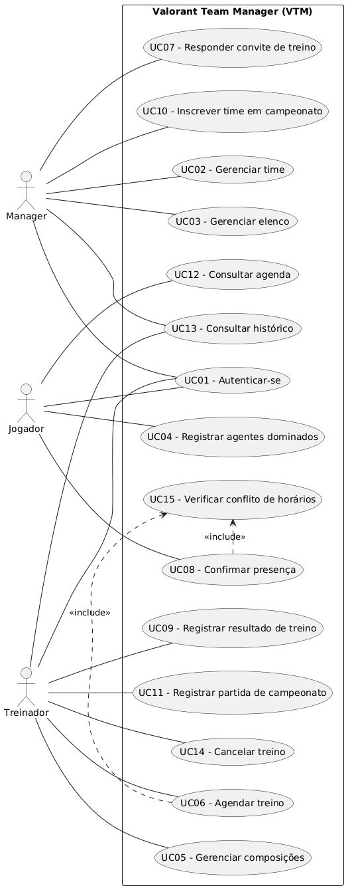
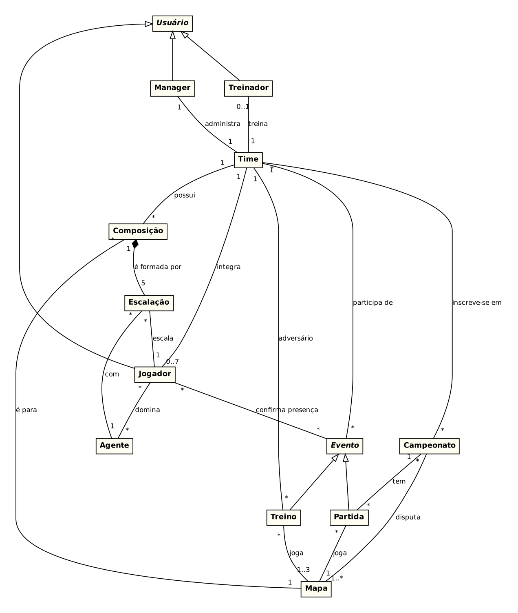
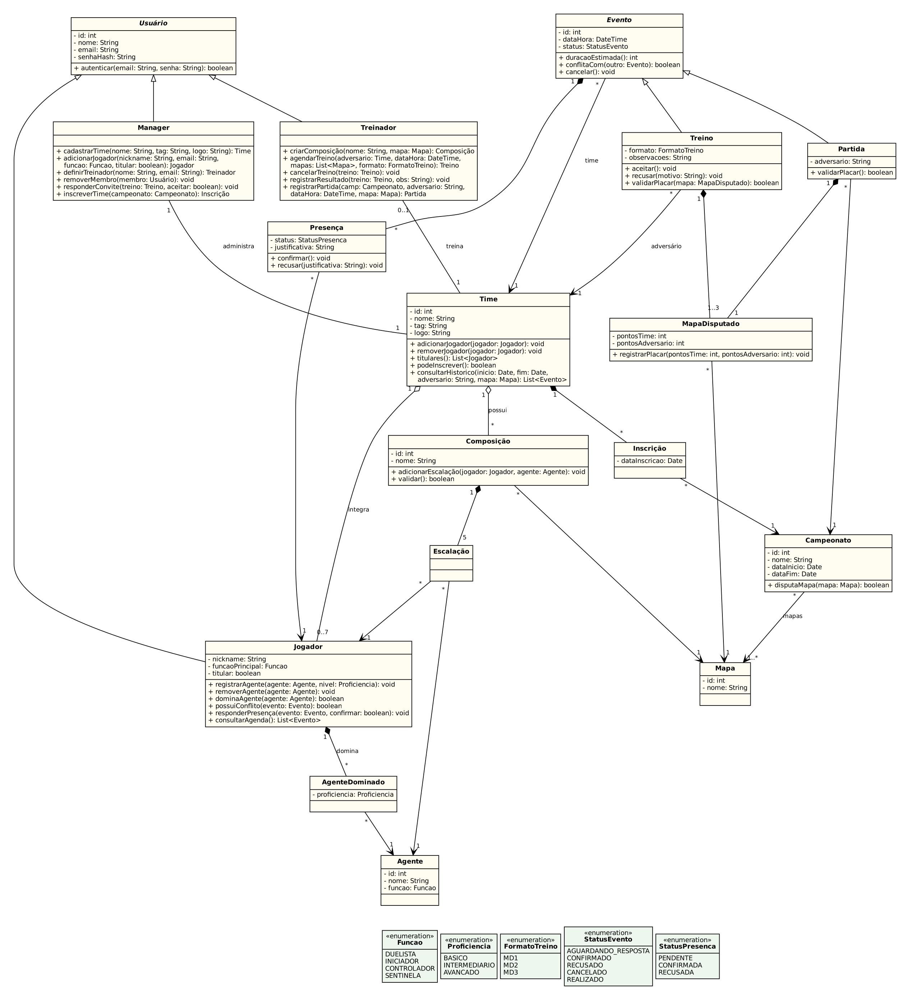

# Diagramas — Valorant Team Manager (VTM)

Voltar para a [Documentação do Projeto](Documenta%C3%A7%C3%A3o%20do%20Projeto.md).

## Sumário

1. [Diagrama de casos de uso](#1-diagrama-de-casos-de-uso)
2. [Diagrama de classes: modelo conceitual](#2-diagrama-de-classes-modelo-conceitual)
3. [Diagrama de classes: modelo de domínio](#3-diagrama-de-classes-modelo-de-domínio)
4. [Segundo diagrama UML](#4-segundo-diagrama-uml)

---

## 1. Diagrama de casos de uso

*Figura 1 – Diagrama de casos de uso do Valorant Team Manager.*

**Atores:** Manager, Treinador e Jogador.

| ID | Caso de uso | Atores | Requisitos |
|----|-------------|--------|------------|
| UC01 | Autenticar-se | Manager, Treinador, Jogador | RF01 |
| UC02 | Gerenciar time | Manager | RF02 |
| UC03 | Gerenciar elenco | Manager | RF03 |
| UC04 | Registrar agentes dominados | Jogador | RF04 |
| UC05 | Gerenciar composições | Treinador | RF05 |
| UC06 | Agendar treino | Treinador | RF06 |
| UC07 | Responder convite de treino | Manager | RF07 |
| UC08 | Confirmar presença | Jogador | RF08 |
| UC09 | Registrar resultado de treino | Treinador | RF09 |
| UC10 | Inscrever time em campeonato | Manager | RF10 |
| UC11 | Registrar partida de campeonato | Treinador | RF11 |
| UC12 | Consultar agenda | Jogador | RF08 |
| UC13 | Consultar histórico | Treinador, Manager | RF12 |
| UC14 | Cancelar treino | Treinador | RF06 |
| UC15 | Verificar conflito de horários | (incluído por UC06 e UC08) | RN04 |

**Relacionamentos:** UC06 e UC08 fazem `«include»` de UC15, que verifica a sobreposição de horários dos jogadores (RN04). Como o comportamento é compartilhado por dois casos de uso, foi separado em UC15.

---

## 2. Diagrama de classes: modelo conceitual

*Figura 2 – Modelo conceitual: entidades do domínio e seus relacionamentos, sem detalhes de implementação.*

- **Usuário** é generalizado em Manager, Treinador e Jogador.
- **Evento** é generalizado em Treino e Partida, pois ambos ocupam horário na agenda dos jogadores (RN04).
- **Escalação** liga um jogador a um agente dentro de uma composição, que tem exatamente 5 escalações (RN01).
- As associações muitos-para-muitos **domina** (Jogador e Agente), **confirma presença** (Jogador e Evento) e **inscreve-se em** (Time e Campeonato) carregam informações próprias e viram classes de associação no modelo de domínio.

---

## 3. Diagrama de classes: modelo de domínio

*Figura 3 – Modelo de domínio, com atributos tipados, métodos, multiplicidades e navegabilidade.*

**Decisões de projeto**

- **Classes de associação:** `AgenteDominado` (proficiência do jogador em cada agente), `Presença` (resposta do jogador a um evento) e `Inscrição` (time em campeonato).
- **Navegabilidade:** as setas indicam quem conhece quem. Por exemplo, `Escalação` conhece `Jogador` e `Agente`, mas eles não conhecem a escalação.
- **Regras de negócio nos métodos:** `Composição.validar()` (RN01 e RN02), `Time.adicionarJogador()` (RN03), `Evento.conflitaCom()` e `Jogador.possuiConflito()` (RN04), `Treino.aceitar()` (RN05), `Time.podeInscrever()` (RN06), `Treino.validarPlacar()` (RN07) e `Partida.validarPlacar()` (RN08).
- **Duração do evento:** `Evento.duracaoEstimada()` considera 1 hora por mapa.
- **Enumerações:** `Funcao`, `Proficiencia`, `FormatoTreino`, `StatusEvento` e `StatusPresenca`.

---

## 4. Segundo diagrama UML

> *A ser preenchido*
