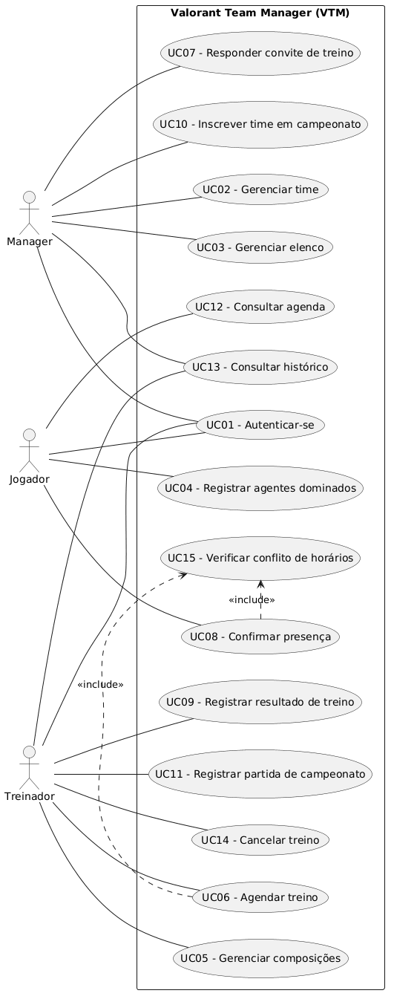

# Documentação do Projeto — Valorant Team Manager (VTM)

**Disciplina:** Análise e Projeto de Sistemas (APS)
**Aluno:** Olavo Appel Neto

## Sumário

1. [Descrição e delimitação do escopo](#1-descrição-e-delimitação-do-escopo)
2. [Fase de análise](#2-fase-de-análise)
3. [Fase de projeto](#3-fase-de-projeto)
4. [Protótipo do sistema](#4-protótipo-do-sistema)
5. [Considerações finais](#5-considerações-finais)
6. [Referências](#6-referências)

---

## 1. Descrição e delimitação do escopo

### 1.1 Cenário

O Valorant é um FPS tático 5x5 em que duas equipes se alternam entre ataque e defesa em diferentes mapas. Cada jogador escolhe um agente (personagem) de uma das quatro funções: duelista, iniciador, controlador ou sentinela. Em campeonatos, o desempenho de um time depende muito da preparação: quais agentes cada jogador domina, qual composição de agentes é a mais forte em cada mapa e quanto o time treina contra adversários.

O **Valorant Team Manager (VTM)** é um sistema web que apoia essa preparação, reunindo em um só lugar o elenco, as composições por mapa, os treinos e a participação em campeonatos.

### 1.2 Propósito

Organizar a rotina competitiva de uma equipe de Valorant, substituindo planilhas e mensagens soltas em aplicativos de conversa por um registro único, consultável e padronizado.

### 1.3 Contexto de uso

O sistema é usado no dia a dia de times amadores, universitários e semiprofissionais que disputam campeonatos. O treinador define composições e marca treinos; os jogadores consultam suas funções, agentes e agenda; o manager mantém o cadastro do time e sua inscrição em campeonatos.

### 1.4 Público-alvo

- **Treinador (coach):** monta composições, agenda treinos e acompanha o desempenho do time.
- **Jogador:** consulta composições, agenda e confirma presença; mantém seus agentes principais.
- **Manager (Gerente do time):** administra o elenco e inscreve o time em campeonatos.

### 1.5 Problema que o sistema resolve

- As composições por mapa ficam espalhadas em planilhas, imagens e conversas, sem versão única.
- Não há controle claro de quais agentes cada jogador domina, o que gera composições impossíveis de executar.
- Combinar treinos com outros times é feito de forma manual e desorganizada, com conflitos de horário e faltas.
- O histórico de treinos e partidas não é registrado, dificultando a análise de evolução do time.

### 1.6 Funcionalidades contempladas

- Cadastro e gerenciamento do time e do elenco (jogadores, função e papel no time).
- Registro dos agentes que cada jogador domina.
- Montagem de composições de agentes por mapa, associando um agente a cada jogador.
- Agendamento de treinos (scrims) com outros times, com convite, aceite ou recusa e confirmação de presença dos jogadores.
- Registro do resultado e de observações dos treinos.
- Cadastro de campeonatos e inscrição do time, com o conjunto de mapas disputados.
- Registro das partidas do campeonato e dos resultados.
- Autenticação e controle de acesso por perfil (treinador, jogador, manager).

### 1.7 Fora do escopo

- Integração com a API oficial da Riot Games ou importação automática de estatísticas.
- Transmissão ao vivo, chat em tempo real e comunicação por voz.
- Gestão financeira, patrocínios e contratos.
- Organização de campeonatos (chaveamento e arbitragem); o sistema apenas registra a participação do time.

### 1.8 Atores identificados (preliminar)

| Ator | Descrição |
|------|-----------|
| Treinador | Responsável técnico; define composições e organiza treinos |
| Jogador | Membro do elenco; consulta informações e confirma presença |
| Manager | Administra o time e as inscrições em campeonatos |

---

## 2. Fase de análise

### 2.1 Requisitos funcionais

| ID | Requisito | Ator |
|----|-----------|------|
| RF01 | O sistema deve permitir que o usuário se autentique com e-mail e senha e acesse apenas as funcionalidades do seu perfil (treinador, jogador ou manager), e que o manager crie a própria conta no primeiro acesso. | Todos |
| RF02 | O sistema deve permitir que o manager cadastre e edite os dados do time (nome, tag e logo). | Manager |
| RF03 | O sistema deve permitir que o manager adicione e remova membros do time (jogadores e treinador), informando nickname, e-mail, papel (titular, reserva ou treinador) e, para jogadores, a função principal, criando o acesso do novo membro ao sistema. | Manager |
| RF04 | O sistema deve permitir que o jogador registre os agentes que domina, informando o nível de proficiência de cada um (básico, intermediário ou avançado). | Jogador |
| RF05 | O sistema deve permitir que o treinador crie uma composição para um mapa, associando um agente a cada jogador titular. | Treinador |
| RF06 | O sistema deve permitir que o treinador edite, exclua e consulte as composições do time, filtrando por mapa. | Treinador |
| RF07 | O sistema deve permitir que o treinador agende um treino (scrim) com outro time cadastrado, informando data, horário, mapas e formato (MD1, MD2 ou MD3). | Treinador |
| RF08 | O sistema deve permitir que o manager do time convidado aceite ou recuse o convite de treino recebido. | Manager |
| RF09 | O sistema deve permitir que o jogador confirme ou recuse sua presença em um treino ou partida agendados. | Jogador |
| RF10 | O sistema deve permitir que o treinador registre o resultado de um treino (placar por mapa) e observações sobre o desempenho do time. | Treinador |
| RF11 | O sistema deve permitir que o manager cadastre um campeonato (nome, datas e mapas disputados) e inscreva o time nele. | Manager |
| RF12 | O sistema deve permitir que o treinador registre as partidas de um campeonato (adversário, data, mapa e resultado). | Treinador |
| RF13 | O sistema deve exibir ao jogador a agenda do time, com os treinos e as partidas futuras e o status de sua confirmação. | Jogador |
| RF14 | O sistema deve permitir consultar o histórico de treinos e partidas, filtrando por período, adversário e mapa. | Treinador, Manager |
| RF15 | O sistema deve permitir que o treinador cancele um treino agendado, notificando o time adversário e os jogadores. | Treinador |

### 2.2 Requisitos não funcionais

| ID | Categoria | Requisito |
|----|-----------|-----------|
| RNF01 | Desempenho | As consultas (agenda, composições e histórico) devem responder em até 3 segundos em 95% das requisições, com até 100 usuários simultâneos. |
| RNF02 | Usabilidade | O sistema deve ser responsivo e utilizável em computadores e celulares, e um usuário novo deve conseguir consultar sua agenda sem treinamento prévio. |
| RNF03 | Segurança | As senhas devem ser armazenadas com hash e toda comunicação deve usar HTTPS. |
| RNF04 | Segurança | O acesso às funcionalidades deve ser controlado por perfil, e um usuário só pode ver e alterar dados do seu próprio time. |
| RNF05 | Manutenibilidade | O sistema deve ser organizado em camadas (apresentação, regras de negócio e persistência), de modo que uma alteração em uma camada não exija mudanças nas demais. |
| RNF06 | Disponibilidade | O sistema deve estar disponível em pelo menos 95% do tempo, medido mensalmente. |
| RNF07 | Compatibilidade | O sistema deve funcionar nas duas últimas versões dos navegadores Chrome, Firefox e Edge. |
| RNF08 | Confiabilidade | Os dados devem ter backup automático diário, com possibilidade de restauração. |

### 2.3 Regras de negócio

| ID | Regra |
|----|-------|
| RN01 | Uma composição deve ter exatamente 5 jogadores titulares, cada um com um agente, e um mesmo agente não pode aparecer duas vezes na mesma composição. |
| RN02 | Um jogador só pode ser escalado em uma composição com um agente que conste na sua lista de agentes dominados. |
| RN03 | O elenco pode ter no máximo 5 titulares, 2 reservas e 1 treinador, e um membro só pode pertencer a um time ativo por vez. |
| RN04 | Um jogador não pode ser escalado nem confirmar presença em dois eventos (treinos ou partidas) com horários sobrepostos. |
| RN05 | Um treino só é considerado confirmado depois que o manager do time convidado aceita o convite, e não pode ser agendado para uma data passada. |
| RN06 | Um time só pode ser inscrito em um campeonato se tiver pelo menos 5 jogadores titulares cadastrados. |
| RN07 | O resultado de um treino ou partida só pode ser registrado depois da data e do horário do evento. |
| RN08 | Somente o treinador pode criar e alterar composições, agendar e cancelar treinos e registrar resultados, e somente o manager pode alterar o elenco, as inscrições em campeonatos e responder aos convites de treino. |
| RN09 | Em um treino, cada mapa tem 24 rounds (12 em cada lado, ataque e defesa), independentemente do placar, e a soma dos pontos das duas equipes no mapa deve ser 24. |
| RN10 | Em uma partida de campeonato, vence o mapa a equipe que chegar a 13 rounds com pelo menos 2 de diferença; se o placar chegar a 12 a 12, o mapa segue em prorrogação até uma equipe abrir 2 rounds de vantagem. |

### 2.4 Documento de requisitos

#### Documento de Especificação de Requisitos

| | |
|---|---|
| **Projeto / Sistema** | Valorant Team Manager (VTM) |
| **Cliente / Solicitante** | Não se aplica (projeto acadêmico). Disciplina de Análise e Projeto de Sistemas, Prof. Mateus de Freitas Invernisi |
| **Responsável** | Olavo Appel Neto |
| **Data** | Novembro de 2026 |
| **Versão** | 1.0 |

#### 2.4.1 Introdução

##### 2.4.1.1 Sobre este documento

Este documento apresenta e organiza os requisitos levantados para o Valorant Team Manager (VTM), servindo de referência para as etapas de projeto, desenvolvimento, testes e validação.

##### 2.4.1.2 Descrição do Mini-Mundo

O Valorant é um jogo de FPS tático 5x5 em que duas equipes se alternam entre ataque e defesa em diferentes mapas. Cada jogador escolhe um agente (personagem) de uma das quatro funções: duelista, iniciador, controlador ou sentinela. Times amadores, universitários e semiprofissionais disputam campeonatos e, para se preparar, definem composições de agentes para cada mapa e realizam treinos (scrims) contra outros times.

Hoje esse processo é manual: as composições ficam em planilhas, imagens e conversas de Discord, os treinos são combinados por mensagens e não há registro organizado dos resultados.

Os principais envolvidos são o **treinador**, que monta composições e organiza treinos; o **jogador**, que informa os agentes que domina e confirma presença; e o **manager**, que administra o elenco e inscreve o time em campeonatos. As entidades relevantes são time, jogador, agente, mapa, composição, treino, campeonato e partida. As regras do domínio incluem composições com 5 jogadores e agentes não repetidos, e jogadores escalados apenas com agentes que dominam.

##### 2.4.1.3 Propósito do Sistema
Organizar a rotina competitiva de uma equipe de Valorant em um registro único, consultável e padronizado, reunindo elenco, agentes dominados, composições por mapa, treinos e participação em campeonatos. Espera-se reduzir composições inviáveis, conflitos de horário e faltas em treinos, além de manter o histórico para acompanhar a evolução do time.

#### 2.4.2 Requisitos Funcionais

| ID | Descrição | Prioridade | Depende de |
|----|-----------|------------|------------|
| RF01 | O sistema deve permitir que o usuário se autentique com e-mail e senha e acesse apenas as funcionalidades do seu perfil (treinador, jogador ou manager), e que o manager crie a própria conta no primeiro acesso. | Alta | — |
| RF02 | O sistema deve permitir que o manager cadastre e edite os dados do time (nome, tag e logo). | Alta | RF01 |
| RF03 | O sistema deve permitir que o manager adicione e remova membros do time (jogadores e treinador), informando nickname, e-mail, papel (titular, reserva ou treinador) e, para jogadores, a função principal, criando o acesso do novo membro ao sistema. | Alta | RF01, RF02 |
| RF04 | O sistema deve permitir que o jogador registre os agentes que domina, informando o nível de proficiência de cada um (básico, intermediário ou avançado). | Alta | RF01, RF03 |
| RF05 | O sistema deve permitir que o treinador crie uma composição para um mapa, associando um agente a cada jogador titular. | Alta | RF03, RF04 |
| RF06 | O sistema deve permitir que o treinador edite, exclua e consulte as composições do time, filtrando por mapa. | Média | RF05 |
| RF07 | O sistema deve permitir que o treinador agende um treino (scrim) com outro time cadastrado, informando data, horário, mapas e formato (MD1, MD2 ou MD3). | Alta | RF02, RF03 |
| RF08 | O sistema deve permitir que o manager do time convidado aceite ou recuse o convite de treino recebido. | Alta | RF07 |
| RF09 | O sistema deve permitir que o jogador confirme ou recuse sua presença em um treino ou partida agendados. | Média | RF07, RF12 |
| RF10 | O sistema deve permitir que o treinador registre o resultado de um treino (placar por mapa) e observações sobre o desempenho do time. | Média | RF07 |
| RF11 | O sistema deve permitir que o manager cadastre um campeonato (nome, datas e mapas disputados) e inscreva o time nele. | Média | RF02 |
| RF12 | O sistema deve permitir que o treinador registre as partidas de um campeonato (adversário, data, mapa e resultado). | Média | RF11 |
| RF13 | O sistema deve exibir ao jogador a agenda do time, com os treinos e as partidas futuras e o status de sua confirmação. | Média | RF09 |
| RF14 | O sistema deve permitir consultar o histórico de treinos e partidas, filtrando por período, adversário e mapa. | Baixa | RF10, RF12 |
| RF15 | O sistema deve permitir que o treinador cancele um treino agendado, notificando o time adversário e os jogadores. | Baixa | RF07 |

#### 2.4.3 Requisitos Não Funcionais

| ID | Descrição | Categoria | Prioridade | Depende de |
|----|-----------|-----------|------------|------------|
| RNF01 | As consultas (agenda, composições e histórico) devem responder em até 3 segundos em 95% das requisições, com até 100 usuários simultâneos. | Desempenho | Alta | RF06, RF13, RF14 |
| RNF02 | O sistema deve ser responsivo e utilizável em computadores e celulares, e um usuário novo deve conseguir consultar sua agenda sem treinamento prévio. | Usabilidade | Média | RF13 |
| RNF03 | As senhas devem ser armazenadas com hash e toda comunicação deve usar HTTPS. | Segurança | Alta | RF01 |
| RNF04 | O acesso às funcionalidades deve ser controlado por perfil, e um usuário só pode ver e alterar dados do seu próprio time. | Segurança | Alta | RF01 |
| RNF05 | O sistema deve ser organizado em camadas (apresentação, regras de negócio e persistência), de modo que uma alteração em uma camada não exija mudanças nas demais. | Manutenibilidade | Média | — |
| RNF06 | O sistema deve estar disponível em pelo menos 95% do tempo, medido mensalmente. | Disponibilidade | Média | — |
| RNF07 | O sistema deve funcionar nas duas últimas versões dos navegadores Chrome, Firefox e Edge. | Compatibilidade | Média | — |
| RNF08 | Os dados devem ter backup automático diário, com possibilidade de restauração. | Confiabilidade | Média | — |

#### 2.4.4 Regras de Negócio

| ID | Descrição | Prioridade | Depende de |
|----|-----------|------------|------------|
| RN01 | Uma composição deve ter exatamente 5 jogadores titulares, cada um com um agente, e um mesmo agente não pode aparecer duas vezes na mesma composição. | Alta | RF05 |
| RN02 | Um jogador só pode ser escalado em uma composição com um agente que conste na sua lista de agentes dominados. | Alta | RF04, RF05 |
| RN03 | O elenco pode ter no máximo 5 titulares, 2 reservas e 1 treinador, e um membro só pode pertencer a um time ativo por vez. | Alta | RF03 |
| RN04 | Um jogador não pode ser escalado nem confirmar presença em dois eventos (treinos ou partidas) com horários sobrepostos. | Alta | RF09 |
| RN05 | Um treino só é considerado confirmado depois que o manager do time convidado aceita o convite, e não pode ser agendado para uma data passada. | Alta | RF07, RF08 |
| RN06 | Um time só pode ser inscrito em um campeonato se tiver pelo menos 5 jogadores titulares cadastrados. | Média | RF11 |
| RN07 | O resultado de um treino ou partida só pode ser registrado depois da data e do horário do evento. | Média | RF10, RF12 |
| RN08 | Somente o treinador pode criar e alterar composições, agendar e cancelar treinos e registrar resultados, e somente o manager pode alterar o elenco, as inscrições em campeonatos e responder aos convites de treino. | Alta | RF01 |
| RN09 | Em um treino, cada mapa tem 24 rounds (12 em cada lado, ataque e defesa), independentemente do placar, e a soma dos pontos das duas equipes no mapa deve ser 24. | Média | RF10 |
| RN10 | Em uma partida de campeonato, vence o mapa a equipe que chegar a 13 rounds com pelo menos 2 de diferença; se o placar chegar a 12 a 12, o mapa segue em prorrogação até uma equipe abrir 2 rounds de vantagem. | Média | RF12 |

#### 2.4.5 Requisitos Suplementares

| ID | Descrição | Categoria | Prioridade | Depende de |
|----|-----------|-----------|------------|------------|
| RS01 | O sistema deve estar em conformidade com a LGPD, coletando apenas os dados pessoais necessários (nome, nickname e e-mail) e permitindo a exclusão da conta. | Legal | Média | RF01 |
| RS02 | O sistema deve informar que não é afiliado à Riot Games e que Valorant e os nomes dos agentes são marcas de seus respectivos proprietários. | Legal | Baixa | — |
| RS03 | O sistema deve ser acessado por navegador web, sem instalação de software nos computadores dos usuários. | Instalação | Média | — |
| RS04 | A interface deve estar em português do Brasil. | Internacionalização | Baixa | — |
| RS05 | O sistema deve ser acompanhado de um guia de uso com os fluxos principais de cada perfil. | Documentação | Baixa | — |

### 2.5 Diagrama de casos de uso

*Figura 1 – Diagrama de casos de uso do Valorant Team Manager.*

#### Atores

| Ator | Descrição |
|------|-----------|
| Manager | Administra o time, o elenco e as inscrições em campeonatos, e responde aos convites de treino. |
| Treinador | Responsável técnico: monta composições, agenda e cancela treinos e registra resultados e partidas. |
| Jogador | Membro do elenco: informa os agentes que domina, confirma presença e consulta a agenda. |

#### Casos de uso

| ID | Caso de uso | Atores | Requisitos |
|----|-------------|--------|------------|
| UC01 | Autenticar-se | Manager, Treinador, Jogador | RF01 |
| UC02 | Gerenciar time | Manager | RF02 |
| UC03 | Gerenciar elenco | Manager | RF03 |
| UC04 | Registrar agentes dominados | Jogador | RF04 |
| UC05 | Gerenciar composições | Treinador | RF05, RF06 |
| UC06 | Agendar treino | Treinador | RF07 |
| UC07 | Responder convite de treino | Manager | RF08 |
| UC08 | Confirmar presença | Jogador | RF09 |
| UC09 | Registrar resultado de treino | Treinador | RF10 |
| UC10 | Inscrever time em campeonato | Manager | RF11 |
| UC11 | Registrar partida de campeonato | Treinador | RF12 |
| UC12 | Consultar agenda | Jogador | RF13 |
| UC13 | Consultar histórico | Treinador, Manager | RF14 |
| UC14 | Cancelar treino | Treinador | RF15 |
| UC15 | Verificar conflito de horários | (incluído por UC06 e UC08) | RN04 |

#### Relacionamentos

- **UC06 – Agendar treino «include» UC15 – Verificar conflito de horários:** ao agendar, o sistema verifica se algum jogador já tem outro evento no mesmo horário (RN04).
- **UC08 – Confirmar presença «include» UC15 – Verificar conflito de horários:** ao confirmar presença, o sistema faz a mesma verificação. Por ser um comportamento compartilhado por dois casos de uso, ele foi separado em UC15.

### 2.6 Documentação dos casos de uso

Cada caso de uso é descrito com seus atores, requisitos e regras de negócio relacionados, pré-condições, fluxo principal, fluxos alternativos e pós-condições. Os fluxos alternativos indicam o passo do fluxo principal em que ocorrem.

---

#### UC01 – Autenticar-se

- **Atores:** Manager, Treinador, Jogador
- **Requisitos:** RF01
- **Regras de negócio:** RN08
- **Pré-condições:** o usuário possui uma conta no sistema (criada pelo manager no UC03) ou é um manager realizando o primeiro acesso (A3).

**Fluxo principal**
1. O usuário acessa a tela de login.
2. O usuário informa e-mail e senha.
3. O sistema valida as credenciais.
4. O sistema identifica o perfil do usuário (manager, treinador ou jogador).
5. O sistema exibe a página inicial com as funcionalidades do perfil.

**Fluxos alternativos**
- **A1 – Credenciais inválidas (passo 3):** o sistema informa que e-mail ou senha estão incorretos e retorna ao passo 2.
- **A2 – Campos obrigatórios vazios (passo 2):** o sistema indica os campos que precisam ser preenchidos e retorna ao passo 2.
- **A3 – Primeiro acesso do manager (passo 1):** o usuário sem conta seleciona "Criar conta de manager" e informa nome, e-mail e senha. O sistema valida os dados, cria a conta com o perfil de manager e segue no passo 5, direcionando o manager para o cadastro do time (UC02).
- **A4 – E-mail já cadastrado (A3):** o sistema informa que o e-mail já possui conta e retorna ao formulário de criação.
- **A5 – Primeiro acesso de jogador ou treinador (passo 1):** o usuário acessa o link recebido por e-mail (enviado no UC03), define a sua senha e o sistema o autentica, seguindo no passo 5.

**Pós-condições:** o usuário está autenticado e acessa apenas as funcionalidades do seu perfil.

---

#### UC02 – Gerenciar time

- **Atores:** Manager
- **Requisitos:** RF02
- **Regras de negócio:** RN08
- **Pré-condições:** o manager está autenticado.

**Fluxo principal**
1. O manager acessa a opção "Meu time".
2. O sistema exibe os dados atuais do time (ou um formulário vazio, se o time ainda não foi cadastrado).
3. O manager informa ou altera nome, tag e logo do time.
4. O manager solicita salvar.
5. O sistema valida os dados e registra o time.
6. O sistema exibe mensagem de confirmação.

**Fluxos alternativos**
- **A1 – Dados obrigatórios ausentes (passo 5):** o sistema indica os campos faltantes e retorna ao passo 3.
- **A2 – Nome ou tag já utilizados por outro time (passo 5):** o sistema informa o conflito e retorna ao passo 3.
- **A3 – Logo em formato inválido ou muito grande (passo 5):** o sistema rejeita o arquivo e retorna ao passo 3.
- **A4 – Cancelamento (passo 3):** o manager cancela e o sistema descarta as alterações.

**Pós-condições:** os dados do time estão cadastrados ou atualizados.

---

#### UC03 – Gerenciar elenco

- **Atores:** Manager
- **Requisitos:** RF03
- **Regras de negócio:** RN03, RN08
- **Pré-condições:** o manager está autenticado e o time está cadastrado (UC02).

**Fluxo principal (adicionar membro)**
1. O manager acessa a opção "Elenco".
2. O sistema lista os membros atuais do time (jogadores e treinador).
3. O manager seleciona "Adicionar membro".
4. O manager informa nickname, e-mail e o papel no time (titular, reserva ou treinador) e, no caso de jogadores, a função principal (duelista, iniciador, controlador ou sentinela).
5. O sistema valida os dados e as regras do elenco (RN03).
6. O sistema adiciona o membro, cria o seu acesso ao sistema, envia ao e-mail informado um link para definir a senha (UC01, A5) e atualiza a lista.

**Fluxos alternativos**
- **A1 – Remover membro (passo 3):** o manager seleciona um membro e escolhe "Remover". Se for um jogador, o sistema informa as composições e os treinos futuros em que ele aparece. O sistema solicita confirmação e, ao confirmar, remove o membro do time e o jogador das composições afetadas.
- **A2 – Limite do elenco atingido (passo 5):** se o time já tem 5 titulares, 2 reservas ou 1 treinador, o sistema informa o limite (RN03) e não adiciona o membro.
- **A3 – Membro já pertence a outro time ativo (passo 5):** o sistema informa o conflito (RN03) e não adiciona o membro.
- **A4 – Dados obrigatórios ausentes (passo 5):** o sistema indica os campos faltantes e retorna ao passo 4.
- **A5 – Cancelamento (passo 4):** o manager cancela e o sistema descarta os dados informados.

**Pós-condições:** o time está atualizado e os novos membros têm acesso ao sistema.

---

#### UC04 – Registrar agentes dominados

- **Atores:** Jogador
- **Requisitos:** RF04
- **Regras de negócio:** RN02
- **Pré-condições:** o jogador está autenticado e pertence a um time.

**Fluxo principal**
1. O jogador acessa a opção "Meus agentes".
2. O sistema exibe os agentes disponíveis, agrupados por função, e os agentes já registrados pelo jogador.
3. O jogador seleciona um agente.
4. O jogador informa o nível de proficiência (básico, intermediário ou avançado).
5. O jogador solicita salvar.
6. O sistema registra o agente e atualiza a lista de agentes dominados.

**Fluxos alternativos**
- **A1 – Alterar proficiência (passo 3):** o jogador seleciona um agente já registrado, altera o nível e o sistema atualiza o registro.
- **A2 – Remover agente (passo 3):** o jogador seleciona um agente registrado e escolhe "Remover". Se o agente estiver atribuído ao jogador em alguma composição, o sistema impede a remoção (RN02) e informa quais composições o utilizam. Caso contrário, remove o agente da lista.
- **A3 – Nível de proficiência não informado (passo 5):** o sistema solicita o nível e retorna ao passo 4.

**Pós-condições:** a lista de agentes dominados do jogador está atualizada.

---

#### UC05 – Gerenciar composições

- **Atores:** Treinador
- **Requisitos:** RF05, RF06
- **Regras de negócio:** RN01, RN02, RN08
- **Pré-condições:** o treinador está autenticado, o time tem 5 jogadores titulares e cada titular possui agentes registrados (UC04).

**Fluxo principal (criar composição)**
1. O treinador acessa a opção "Composições".
2. O treinador seleciona "Nova composição".
3. O treinador escolhe o mapa e informa um nome para a composição.
4. O sistema exibe os 5 titulares e, para cada um, a lista de agentes que ele domina.
5. O treinador atribui um agente a cada titular.
6. O treinador solicita salvar.
7. O sistema valida a composição (RN01 e RN02).
8. O sistema registra a composição e a exibe na lista.

**Fluxos alternativos**
- **A1 – Consultar composições (passo 1):** o treinador filtra a lista por mapa e visualiza os detalhes de uma composição.
- **A2 – Editar composição (passo 2):** o treinador seleciona uma composição existente, altera mapa, nome ou agentes e salva. O sistema repete a validação do passo 7.
- **A3 – Excluir composição (passo 2):** o treinador seleciona uma composição e escolhe "Excluir". O sistema solicita confirmação e, ao confirmar, remove a composição.
- **A4 – Agente repetido (passo 7):** o sistema informa que um mesmo agente não pode aparecer duas vezes (RN01) e retorna ao passo 5.
- **A5 – Agente não dominado pelo jogador (passo 5):** o sistema não permite selecionar agentes fora da lista do jogador (RN02).
- **A6 – Composição incompleta (passo 7):** se algum titular está sem agente, o sistema informa que a composição precisa de 5 jogadores (RN01) e retorna ao passo 5.
- **A7 – Cancelamento (passo 5):** o treinador cancela e o sistema descarta as alterações.

**Pós-condições:** a composição está criada, alterada ou excluída, e a lista de composições do time está atualizada.

---

#### UC06 – Agendar treino

- **Atores:** Treinador
- **Requisitos:** RF07
- **Regras de negócio:** RN04, RN05, RN08
- **Pré-condições:** o treinador está autenticado e existe outro time cadastrado no sistema.

**Fluxo principal**
1. O treinador acessa a opção "Treinos" e seleciona "Agendar treino".
2. O treinador seleciona o time adversário.
3. O treinador informa data, horário, mapas e formato do treino (MD1, MD2 ou MD3).
4. O treinador confirma o agendamento.
5. O sistema valida que a data e o horário não estão no passado (RN05).
6. O sistema executa o caso de uso **UC15 – Verificar conflito de horários** para os jogadores titulares do time.
7. Não havendo conflitos, o sistema registra o treino com o status "Aguardando resposta" e envia o convite ao manager do time adversário.
8. O sistema exibe mensagem de confirmação.

**Fluxos alternativos**
- **A1 – Data ou horário no passado (passo 5):** o sistema informa que o treino não pode ser agendado para uma data passada (RN05) e retorna ao passo 3.
- **A2 – Conflito de horário (passo 6):** o sistema informa os jogadores e os eventos em conflito (RN04) e retorna ao passo 3 para que o treinador escolha outro horário.
- **A3 – Dados obrigatórios ausentes (passo 4):** o sistema indica os campos faltantes e retorna ao passo 3.
- **A4 – Quantidade de mapas incompatível com o formato (passo 4):** o sistema informa a inconsistência e retorna ao passo 3.
- **A5 – Adversário igual ao próprio time (passo 2):** o sistema não permite a seleção.
- **A6 – Cancelamento (passo 3):** o treinador cancela e o sistema descarta os dados informados.

**Pós-condições:** o treino está registrado com o status "Aguardando resposta" e o convite foi enviado ao time adversário.

---

#### UC07 – Responder convite de treino

- **Atores:** Manager (do time convidado)
- **Requisitos:** RF08
- **Regras de negócio:** RN05, RN08
- **Pré-condições:** o manager está autenticado e existe um convite de treino pendente para o seu time.

**Fluxo principal**
1. O manager acessa a opção "Convites".
2. O sistema lista os convites pendentes.
3. O manager seleciona um convite e visualiza os detalhes (time organizador, data, horário, mapas e formato).
4. O manager escolhe "Aceitar".
5. O sistema altera o status do treino para "Confirmado" (RN05).
6. O sistema notifica o treinador do time organizador e os jogadores do time convidado, que passam a poder confirmar presença (UC08).
7. O sistema exibe mensagem de confirmação.

**Fluxos alternativos**
- **A1 – Recusar convite (passo 4):** o manager escolhe "Recusar" e, opcionalmente, informa o motivo. O sistema altera o status do treino para "Recusado" e notifica o treinador do time organizador.
- **A2 – Convite cancelado pelo organizador (passo 3):** o sistema informa que o convite não está mais disponível e remove-o da lista.
- **A3 – Data do treino já passou (passo 4):** o sistema marca o convite como expirado e não permite aceitá-lo.

**Pós-condições:** o treino está com o status "Confirmado" ou "Recusado" e os envolvidos foram notificados.

---

#### UC08 – Confirmar presença

- **Atores:** Jogador
- **Requisitos:** RF09
- **Regras de negócio:** RN04
- **Pré-condições:** o jogador está autenticado e existe um treino confirmado ou uma partida futura do seu time com resposta pendente.

**Fluxo principal**
1. O jogador acessa a opção "Agenda".
2. O jogador seleciona um evento com resposta pendente.
3. O jogador escolhe "Confirmar presença".
4. O sistema executa o caso de uso **UC15 – Verificar conflito de horários** para o jogador.
5. Não havendo conflito, o sistema registra a presença como "Confirmada".
6. O sistema exibe mensagem de confirmação e disponibiliza a resposta ao treinador.

**Fluxos alternativos**
- **A1 – Recusar presença (passo 3):** o jogador escolhe "Recusar" e, opcionalmente, informa uma justificativa. O sistema registra a presença como "Recusada".
- **A2 – Conflito de horário (passo 4):** o sistema informa o evento em conflito (RN04) e não registra a confirmação.
- **A3 – Alterar resposta anterior (passo 2):** o jogador seleciona um evento já respondido, desde que ainda não tenha ocorrido, e altera a resposta. O sistema repete o fluxo a partir do passo 4.
- **A4 – Evento cancelado ou já realizado (passo 2):** o sistema informa que não é possível responder e não registra a presença.

**Pós-condições:** a resposta de presença do jogador está registrada e visível ao treinador.

---

#### UC09 – Registrar resultado de treino

- **Atores:** Treinador
- **Requisitos:** RF10
- **Regras de negócio:** RN07, RN08, RN09
- **Pré-condições:** o treinador está autenticado e existe um treino confirmado cuja data e horário já passaram.

**Fluxo principal**
1. O treinador acessa a opção "Treinos" e seleciona um treino realizado.
2. O sistema exibe os mapas do treino.
3. O treinador informa o placar de cada mapa.
4. O treinador informa observações sobre o desempenho do time (opcional).
5. O treinador solicita salvar.
6. O sistema valida os dados e a data do evento (RN07).
7. O sistema registra o resultado e altera o status do treino para "Realizado".

**Fluxos alternativos**
- **A1 – Treino ainda não ocorreu (passo 1):** o sistema não permite registrar o resultado antes da data e do horário do treino (RN07).
- **A2 – Placar inválido (passo 6):** o sistema indica os valores inválidos (vazios, negativos, não numéricos ou cuja soma por mapa não seja 24 rounds, conforme RN09) e retorna ao passo 3.
- **A3 – Editar resultado já registrado (passo 1):** o treinador seleciona um treino com resultado, altera os dados e o sistema atualiza o registro.
- **A4 – Treino cancelado ou não confirmado (passo 1):** o sistema não permite registrar resultado.

**Pós-condições:** o resultado e as observações do treino estão registrados e disponíveis no histórico.

---

#### UC10 – Inscrever time em campeonato

- **Atores:** Manager
- **Requisitos:** RF11
- **Regras de negócio:** RN06, RN08
- **Pré-condições:** o manager está autenticado e o time tem pelo menos 5 jogadores titulares cadastrados.

**Fluxo principal**
1. O manager acessa a opção "Campeonatos" e seleciona "Inscrever time".
2. O manager seleciona "Cadastrar novo campeonato".
3. O manager informa nome, datas de início e fim e os mapas disputados.
4. O manager confirma a inscrição.
5. O sistema valida os dados e verifica se o time possui 5 titulares (RN06).
6. O sistema registra o campeonato e inscreve o time.
7. O sistema exibe mensagem de confirmação.

**Fluxos alternativos**
- **A1 – Campeonato já cadastrado (passo 2):** o manager seleciona um campeonato existente na lista e o sistema apenas inscreve o time nele.
- **A2 – Time sem 5 titulares (passo 5):** o sistema informa quantos titulares faltam (RN06) e não realiza a inscrição.
- **A3 – Data de fim anterior à data de início (passo 5):** o sistema informa o erro e retorna ao passo 3.
- **A4 – Time já inscrito no campeonato (passo 5):** o sistema informa que a inscrição já existe.
- **A5 – Dados obrigatórios ausentes (passo 5):** o sistema indica os campos faltantes e retorna ao passo 3.
- **A6 – Cancelamento (passo 3):** o manager cancela e o sistema descarta os dados informados.

**Pós-condições:** o campeonato está cadastrado e o time está inscrito nele, com o conjunto de mapas definido.

---

#### UC11 – Registrar partida de campeonato

- **Atores:** Treinador
- **Requisitos:** RF12
- **Regras de negócio:** RN07, RN08, RN10
- **Pré-condições:** o treinador está autenticado e o time está inscrito em um campeonato.

**Fluxo principal**
1. O treinador acessa a opção "Campeonatos" e seleciona um campeonato do time.
2. O treinador seleciona "Nova partida".
3. O treinador informa o adversário, a data, o horário e o mapa.
4. O treinador solicita salvar.
5. O sistema valida os dados.
6. O sistema registra a partida com o status "Agendada", que passa a aparecer na agenda dos jogadores para confirmação de presença (UC08).

**Fluxos alternativos**
- **A1 – Registrar resultado (passo 2):** após a data e o horário da partida, o treinador seleciona a partida, informa o placar de cada mapa e salva. O sistema valida o placar (RN10), registra o resultado e altera o status para "Realizada".
- **A2 – Resultado antes do horário da partida (A1):** o sistema não permite registrar o resultado (RN07).
- **A3 – Mapa fora da lista do campeonato (passo 5):** o sistema informa que o mapa não é disputado no campeonato e retorna ao passo 3.
- **A4 – Data fora do período do campeonato (passo 5):** o sistema informa o erro e retorna ao passo 3.
- **A5 – Dados obrigatórios ausentes (passo 5):** o sistema indica os campos faltantes e retorna ao passo 3.
- **A6 – Placar inválido (A1):** se o placar não respeita a regra de 13 rounds com 2 de diferença ou a prorrogação (RN10), o sistema indica o erro e solicita uma nova informação.

**Pós-condições:** a partida está registrada e, se informado, seu resultado também.

---

#### UC12 – Consultar agenda

- **Atores:** Jogador
- **Requisitos:** RF13
- **Regras de negócio:** —
- **Pré-condições:** o jogador está autenticado e pertence a um time.

**Fluxo principal**
1. O jogador acessa a opção "Agenda".
2. O sistema busca os treinos confirmados e as partidas futuras do time.
3. O sistema exibe os eventos em ordem de data, com o status da confirmação de presença do jogador.
4. O jogador seleciona um evento para ver os detalhes (adversário, data, horário, mapas e formato).

**Fluxos alternativos**
- **A1 – Nenhum evento agendado (passo 2):** o sistema exibe a mensagem de que não há eventos futuros.
- **A2 – Filtrar por tipo (passo 3):** o jogador filtra a agenda por treinos ou partidas e o sistema atualiza a lista.
- **A3 – Evento com resposta pendente (passo 4):** o sistema oferece o acesso direto à confirmação de presença (UC08).

**Pós-condições:** nenhuma alteração de dados. O jogador visualizou a agenda do time.

---

#### UC13 – Consultar histórico

- **Atores:** Treinador, Manager
- **Requisitos:** RF14
- **Regras de negócio:** RN08
- **Pré-condições:** o usuário está autenticado como treinador ou manager.

**Fluxo principal**
1. O usuário acessa a opção "Histórico".
2. O sistema exibe os treinos e as partidas realizados pelo time, do mais recente para o mais antigo.
3. O usuário aplica filtros por período, adversário e mapa.
4. O sistema atualiza a lista de acordo com os filtros.
5. O usuário seleciona um item e visualiza os detalhes (placar, mapas e observações).

**Fluxos alternativos**
- **A1 – Nenhum resultado (passo 4):** o sistema informa que nenhum registro corresponde aos filtros.
- **A2 – Período inválido (passo 3):** se a data inicial é posterior à final, o sistema informa o erro e retorna ao passo 3.
- **A3 – Limpar filtros (passo 4):** o usuário limpa os filtros e o sistema volta a exibir a lista completa.

**Pós-condições:** nenhuma alteração de dados. O usuário visualizou o histórico do time.

---

#### UC14 – Cancelar treino

- **Atores:** Treinador
- **Requisitos:** RF15
- **Regras de negócio:** RN08
- **Pré-condições:** o treinador está autenticado e existe um treino do seu time com status "Aguardando resposta" ou "Confirmado" que ainda não ocorreu.

**Fluxo principal**
1. O treinador acessa a opção "Treinos".
2. O treinador seleciona um treino futuro.
3. O treinador escolhe "Cancelar treino".
4. O sistema solicita a confirmação e, opcionalmente, o motivo do cancelamento.
5. O treinador confirma.
6. O sistema altera o status do treino para "Cancelado".
7. O sistema notifica o manager do time adversário e os jogadores convocados.
8. O sistema exibe mensagem de confirmação.

**Fluxos alternativos**
- **A1 – Treinador desiste (passo 5):** o treinador não confirma e o treino permanece inalterado.
- **A2 – Treino já realizado (passo 2):** o sistema não permite cancelar treinos que já ocorreram.
- **A3 – Convite ainda não respondido (passo 6):** o sistema retira o convite da lista de pendentes do time adversário e notifica o manager.

**Pós-condições:** o treino está com o status "Cancelado", os envolvidos foram notificados e o horário dos jogadores foi liberado.

---

#### UC15 – Verificar conflito de horários

- **Atores:** nenhum ator direto. É executado pelo sistema quando incluído por UC06 e UC08.
- **Requisitos:** —
- **Regras de negócio:** RN04
- **Pré-condições:** o caso de uso chamador informa o jogador (ou os jogadores), a data, o horário e a quantidade de mapas do evento.

**Fluxo principal**
1. O sistema recebe a lista de jogadores e o intervalo do evento (início e duração estimada em 1 hora por mapa, que é o limite superior, já que um mapa dura de 30 minutos a 1 hora).
2. O sistema consulta os treinos confirmados e as partidas de cada jogador.
3. O sistema compara os intervalos dos eventos existentes com o do novo evento.
4. Não havendo sobreposição, o sistema retorna "sem conflito" ao caso de uso chamador.

**Fluxos alternativos**
- **A1 – Sobreposição encontrada (passo 3):** o sistema retorna ao caso de uso chamador a lista de jogadores e de eventos em conflito (RN04), e o caso de uso chamador interrompe o seu fluxo.

**Pós-condições:** o resultado da verificação foi devolvido ao caso de uso chamador. Nenhum dado foi alterado.

### 2.7 Diagrama de classes — modelo conceitual

> *A ser preenchido.*

---

## 3. Fase de projeto

### 3.1 Diagrama de classes — modelo de domínio

> *A ser preenchido.*

### 3.2 Segundo diagrama UML

> *A ser preenchido.*

---

## 4. Protótipo do sistema

### 4.1 Mapa do site

> *A ser preenchido.*

### 4.2 Telas

> *A ser preenchido.*

---

## 5. Considerações finais

### 5.1 Principais desafios
> *A ser preenchido.*

### 5.2 Aprendizados (integração entre análise e projeto)
> *A ser preenchido.*

### 5.3 Melhorias futuras
> *A ser preenchido.*

---

## 6. Referências

- **Ferramenta dos diagramas:** PlantUML, por meio do editor online PlantText (planttext.com)
- **Ferramenta do protótipo:** *a definir*
- **Uso de IA:** *a preencher*
- **Bibliografia:** *a preencher*
