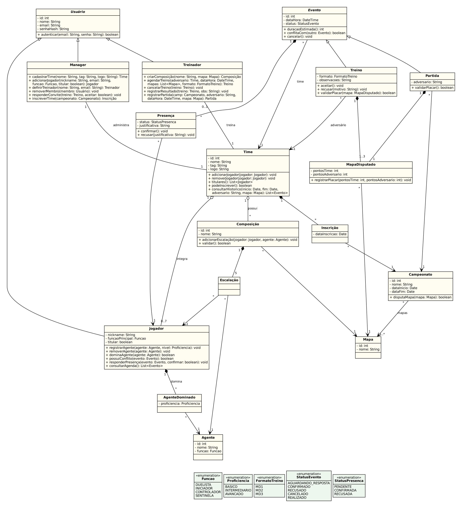

# Valorant Team Manager (VTM)

**Disciplina:** Análise e Projeto de Sistemas (APS) — Bacharelado em Ciência da Computação, 2026/2
**Aluno:** Olavo Appel Neto
**Professor:** Mateus de Freitas Invernisi

## Descrição do sistema

O **Valorant Team Manager (VTM)** é um sistema web para a gestão de equipes de Valorant que disputam campeonatos. Ele centraliza o elenco, os agentes que cada jogador domina, as composições (comps) de agentes por mapa, a agenda de treinos (scrims) com outros times e a participação do time em campeonatos.

O sistema atende managers, treinadores e jogadores de times amadores e semiprofissionais, que hoje organizam essas informações em planilhas e conversas de Discord.

## Diagrama de classes

## Documentação

- [Documentação do Projeto](Documenta%C3%A7%C3%A3o%20do%20Projeto.md): escopo, requisitos, casos de uso, considerações finais e referências
- [Diagramas](Diagramas.md): casos de uso, diagramas de classes (conceitual e de domínio) e segundo diagrama UML
- [Protótipo](Prot%C3%B3tipo.md): mapa do site e telas

## Conclusão / Aprendizado

> *A ser adicionado.*

## Declaração de uso de IA

> *A ser adicionado.*
